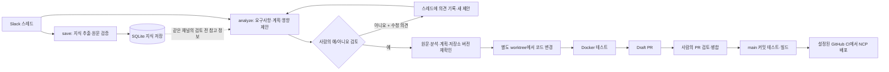

# slack-dev-assistant

팀원끼리 나눈 Slack 스레드 대화를 읽고 개발 요구사항과 구현 계획을 정리하는 TypeScript/Node.js 도구입니다. 봇이 현재 코드를 조사해 변경 범위와 사이드 이펙트를 함께 보여주고, 사람이 **예 · 구현하고 PR 만들기**를 한 번 누르면 코드 수정·테스트·Draft PR 생성으로 이어집니다.

## Slack에서 사용하기

평소처럼 팀원과 대화한 스레드의 링크를 넘깁니다. 요구사항 문서나 정해진 입력 양식을 미리 작성할 필요가 없습니다.

```text
/duduk save <스레드 링크>
/duduk analyze <스레드 링크>
/duduk feedback <작업 ID> <수정 의견>
/duduk status <작업 ID>
```

- **`save`**: 대화에 나온 도메인 지식을 추출해 SQLite에 정규화해 저장합니다. 원문 인용·링크와 연결하며, 추출 결과는 사람이 검토하기 전의 주장으로 보존합니다.
- **`analyze`**: 대화에서 제목·요약·기능 구현·완료 조건을 정리하고, 현재 코드를 근거로 사이드 이펙트와 검증 방법을 제안합니다. **예 · 구현하고 PR 만들기**를 누르면 표시한 요구사항과 계획을 함께 승인합니다.
- **`아니요 · 수정 요청` / `feedback`**: 기존 승인 버튼을 무효화합니다. 수정 의견을 제출하면 원래 스레드에 기록한 뒤 새 제안을 만들고 다시 승인을 받습니다. 입력창을 닫으면 재분석을 시작하지 않습니다.

모델이 대화에서 요구사항과 미정 사항을 추출하고, 인용 검증기는 근거가 실제 원문에 있는지 확인합니다. 사람은 봇이 정리한 기능과 질문이 대화 의도에 맞는지 확인한 뒤 승인합니다. 색상처럼 아직 결정하지 않은 내용을 질문으로 제시하면 수정 의견으로 답할 수 있습니다.



명령은 **스레드 답글창이 아닌 해당 채널의 기본 입력창**에 입력합니다. 같은 채널의 스레드 링크만 받습니다. **로컬의 `serve-slack` 작업 프로세스가 실행 중이어야** 명령·버튼·수정 의견을 처리합니다. 스레드는 명령 처리와 승인 전 확인 시 수집하며 새 메시지를 상시 감시하지 않습니다. 앱의 결과 메시지는 원문에서 제외하고, 접수·전송 기록이 확인된 사람의 수정 의견은 원문 근거에 포함합니다.

구현 승인 전 원문을 다시 수집해 제안 당시 내용과 비교합니다. 원문·분석·계획·저장소 기준이 바뀌었거나 차단 질문이 남아 있으면 구현을 시작하지 않습니다. 표시한 내용으로 새 제안을 만든 뒤 다시 검토해야 합니다. 로컬 CLI의 `review → plan → approve-plan → implement` 절차는 그대로 사용할 수 있습니다.

Slack 도구의 실행 범위는 Draft PR까지입니다. 사람의 병합 뒤 CI 검증·NCP 배포를 연결하는 변경은 [duduk PR #1](https://github.com/oy-ubs4939/duduk/pull/1)에서 검토 중이며, 별도의 운영 설정이 필요합니다. [duduk 배포 가이드](https://github.com/oy-ubs4939/duduk/blob/slack-dev/duduk-connection-20261119/docs/slack-deployment.md)를 확인하세요. Slack 앱 명령어·추가 토큰 설정과 실제 운영 배포는 코드 구현 완료와 별개의 활성화 단계입니다.

앱 설치·토큰·허용 사용자 설정 후 실행합니다. 기존 읽기 전용 앱에는 권한 추가와 재설치가 필요합니다.

```sh
node dist/cli.js serve-slack --config slack-dev.config.json
```

자세한 절차는 [Slack 명령어 연결 가이드](docs/slack-commands.md)에 있습니다. 코드가 설치되어 있어도 Slack 앱과 로컬 작업 프로세스 설정을 마쳐야 명령어가 동작합니다.

## 구현 범위

- Slack Web API를 통한 스레드 수집, 페이지 처리, 메시지 버전과 원문 링크 보존
- Slack Socket Mode의 `/duduk save`, `/duduk analyze`와 사람의 검토·승인
- SQLite의 도메인 지식·관계·원문 근거 저장과 검색
- 프로젝트별 Slack 워크스페이스·채널 허용 범위 확인
- Zod 기반 요구사항·질문·수용 기준 스키마 및 원문 인용 검증
- `confirmed`, `proposed`, `open`, `rejected`, `superseded` 구분
- 원문에 명시된 수용 기준(`source`)과 분석기가 제안한 기준(`derived`) 구분
- SQLite 실행 이력, 불변 스냅샷, 분석 및 사람의 수정 버전, 단계·실패 기록
- JSON·Markdown 결과물, 동일 입력 재사용, 명시적 재분석(`--force`)
- 요구사항·저장소 버전에 연결된 구현 계획과 범위를 지정한 실행 허가
- 별도 Git worktree의 파일 변경, Docker 안에서의 변경 전·후 테스트, 로컬 커밋·diff·검증 보고서
- 선택적으로 푸시·GitHub Draft PR 생성
- 네트워크와 API 키가 필요 없는 합성 예제 및 자동 테스트

명시적인 Slack 명령어 또는 로컬 CLI 명령으로 작업을 시작합니다. `implement`는 모델이 제안한 구조화된 파일 변경만 적용하고, 설정된 테스트 명령만 Docker 안에서 실행합니다.

## 시작하기

Node.js **24 이상**과 npm이 필요합니다. SQLite는 Node.js 내장 `node:sqlite`를 사용하므로 별도 데이터베이스 서버나 네이티브 애드온 설치가 필요하지 않습니다. 일부 Node.js 24 버전은 SQLite experimental 경고를 표시할 수 있습니다.

```sh
git clone https://github.com/vipwhy12/slack-dev-assistant.git
cd slack-dev-assistant
npm ci
npm run check
```

합성 예제를 실행합니다. 이 명령은 Slack이나 모델 API를 호출하지 않습니다.

```sh
node dist/cli.js analyze \
  'https://example.slack.com/archives/CDEMO12345/p1795046400000001' \
  --config examples/project.json \
  --snapshot examples/thread.json \
  --analysis-file examples/analysis.json

node dist/cli.js history --config examples/project.json --limit 20
```

`examples/`의 대화·인물·요구사항은 모두 가상 데이터입니다. 동일 명령을 다시 실행하면 입력이 같은 완료 결과를 재사용합니다. 새 실행을 남기려면 `--force`를 추가합니다. 개발 중에는 `node dist/cli.js` 대신 `npm run dev --`를 사용할 수 있습니다.

## 실제 Slack 연결

1. Slack 앱을 만들고 대상 워크스페이스에 설치합니다. [`examples/slack-app-manifest.json`](examples/slack-app-manifest.json)은 공개 채널 읽기·응답과 `/duduk` 명령어에 필요한 `channels:history`, `chat:write`, `commands`를 요청하고 Socket Mode를 활성화합니다. 설치한 봇을 사용할 채널에 추가합니다. 로컬 수집·분석만 사용할 때는 기존 읽기 전용 토큰으로도 동작합니다.
2. 대상 채널 스레드를 읽을 수 있는 OAuth 토큰을 준비합니다. 공개 채널은 `channels:history`, 비공개 채널은 `groups:history` 권한과 대상 채널 접근 권한이 필요합니다. 현재 `conversations.replies` 공식 문서는 봇·사용자 토큰을 지원 대상으로 안내합니다. 실제 토큰과 채널 조합은 작은 스레드로 먼저 확인하세요.
3. `.env.example`을 `.env`로 복사하고 `SLACK_TOKEN`, `OPENAI_API_KEY`를 설정합니다. Slack 명령어를 받으려면 별도의 `SLACK_APP_TOKEN`, `SLACK_BOT_TOKEN`도 설정합니다. [.env 설정](docs/slack-commands.md#2-토큰-설정)을 확인하세요. `.env`는 CLI를 실행하는 현재 디렉터리에서 읽습니다.
4. 프로젝트 설정에서 실제 워크스페이스와 허용 채널을 지정합니다. 설정 파일에 토큰을 넣지 않습니다.

```json
{
  "projectId": "orders-service",
  "slack": {
    "workspace": "your-workspace",
    "channelIds": ["C0123456789"]
  },
  "storageDir": ".slack-dev",
  "repoPath": ".",
  "model": "gpt-4.1-mini"
}
```

`workspace`는 `.slack.com`을 제외한 서브도메인입니다. `storageDir`, `repoPath`는 **설정 파일 디렉터리 기준**으로 해석합니다. `repoPath`는 분석에서는 선택 사항이며 Git 커밋 정보를 기록하는 데 사용합니다. 계획·구현에서는 변경할 Git 저장소의 경로로 반드시 지정합니다. 현재 CLI·Slack의 유료 `save`·`analyze`·`plan`·`implement`는 비용 계산을 지원하는 `gpt-4.1-mini`만 허용합니다. `save`·`analyze`는 `development` 설정 없이도 사용할 수 있습니다.

```sh
node dist/cli.js analyze \
  'https://your-workspace.slack.com/archives/C0123456789/p1795046400000001' \
  --config project.json
```

실제 분석 시 수집한 스레드 텍스트가 설정된 OpenAI 모델 API로 전송됩니다. 접근 가능한 채널 중에서도 설정에 허용된 채널만 수집합니다. API 키는 환경 변수로 전달하며 결과물과 이력에 저장하지 않습니다. 메시지 텍스트에 포함된 지시문은 분석 대상 데이터로 취급합니다.

Slack API의 권한·보존 정책에 따라 원문을 전부 읽지 못할 수 있습니다. 수집이 불완전하면 `needs_input`으로 기록하고 모델 분석을 중단합니다. 첨부 파일 본문은 수집하지 않으며 첨부 존재와 경고를 보존합니다. 권한 설정 및 API 호출 제한은 [Slack conversations.replies 문서](https://docs.slack.dev/reference/methods/conversations.replies/)를 확인하세요.

## 명령

LLM 키 없이 Slack 연결부터 확인할 수 있습니다. `doctor`는 토큰의 워크스페이스를 검증하고, `collect`는 지정한 스레드를 수집해 `storageDir/collections/<snapshotId>/snapshot.json`에 저장합니다. stdout에는 원문이나 토큰 없이 수집 상태, 메시지 수, 경고 수, 파일 경로만 출력합니다. `doctor` 성공은 인증 확인이며 채널 접근은 `collect`로 검증합니다. 수집 결과는 `analyze --snapshot <snapshotPath>`에 사용할 수 있습니다.

```sh
node dist/cli.js doctor --config slack-dev.config.json
node dist/cli.js collect '<Slack 스레드 URL>' --config slack-dev.config.json
```

| 명령 | 용도 |
| --- | --- |
| `doctor --config <file>` | Slack 인증 및 워크스페이스 일치를 확인합니다. LLM 키는 필요하지 않습니다. |
| `collect <thread-url> --config <file>` | LLM 없이 스레드 원문과 링크를 수집합니다. 부분 수집 시 종료 코드 2를 반환합니다. |
| `serve-slack --config <file>` | Socket Mode로 `/duduk` 명령어와 검토·승인 입력을 받습니다. 프로세스를 계속 실행해야 합니다. |
| `save <thread-url> --config <file>` | 스레드의 도메인 지식을 원문 근거와 함께 정규화해 저장합니다. |
| `save ... --snapshot <file> --knowledge-file <file>` | 저장한 스냅샷과 지식 추출 JSON으로 Slack·모델 호출을 대체합니다. |
| `knowledge [query] --limit <n> --config <file>` | 저장된 프로젝트 지식을 조회·검색합니다. |
| `analyze <thread-url> --config <file>` | Slack 스레드를 수집하고 요구사항을 분석합니다. |
| `analyze ... --snapshot <file>` | 검증된 스냅샷 파일로 Slack 수집을 대체합니다. |
| `analyze ... --analysis-file <file>` | Zod 스키마의 JSON 파일로 모델 호출을 대체합니다. 원문 검증은 그대로 수행합니다. |
| `analyze ... --force` | 같은 입력이어도 새 실행을 생성합니다. |
| `history --config <file> --limit 20` | 실행 목록을 조회합니다. |
| `show <runId> --config <file>` | 실행의 결과·수정 버전·단계·개입 기록을 JSON으로 조회합니다. |
| `review <runId> --file <file> --reason <text> --minutes <n> --config <file>` | 사람이 수정한 분석 JSON을 검증하고 별도 버전으로 기록합니다. |
| `plan <runId> --config <file>` | 분석의 최신 버전과 저장소를 읽어 구현 계획을 만듭니다. |
| `plan <runId> --requirements <id,id> --config <file>` | 선택한 요구사항으로 계획 범위를 제한합니다. |
| `plan <runId> --plan-file <file> --config <file>` | 모델 대신 구조화된 계획 JSON을 검증해 사용합니다. |
| `approve-plan <planId> --reason <text> --config <file>` | 검토·버전·범위를 확인한 뒤 해당 계획에 구현 허가를 발급합니다. |
| `approve-plan ... --allow-pr` | 해당 허가에 GitHub Draft PR 게시 권한을 포함합니다. |
| `implement <planId> --grant <grantId> --config <file>` | 허가된 파일 변경과 Docker 테스트 후 별도 브랜치에 로컬 커밋을 만듭니다. |
| `implement ... --changes-file <file>` | 모델 대신 구조화된 파일 변경 JSON을 검증해 사용합니다. |
| `implement ... --publish` | 검증한 커밋을 허가된 GitHub 저장소에 푸시하고 Draft PR을 만듭니다. |
| `implement ... --resume <implementationRunId>` | 저장한 실행 체크포인트에서 검증·게시를 이어갑니다. |
| `budget --config <file>` | 같은 저장 경로에서 기록한 지식 저장·분석·계획·구현 API의 누적 예약·추정 사용액과 한도를 조회합니다. |

`--snapshot`은 스키마, 스레드 식별자와 메시지 원문 링크를 검증한 뒤 실제 내용으로 `contentHash`를 다시 계산합니다. 파일에 들어 있는 기존 해시를 무결성 서명으로 신뢰하지 않습니다. `--analysis-file`은 `examples/analysis.json`과 같은 분석 객체를 받습니다. 실행 결과 전체를 그대로 넣는 형식은 아닙니다.

`--config`를 생략하면 현재 디렉터리의 `slack-dev.config.json`을 읽습니다. `analyze`는 stdout에 `runId`, `requestRunId`, `status`, `reused`, `reportPath`를 담은 JSON을 출력합니다. 재사용된 경우 `runId`는 원래 분석 실행, `requestRunId`는 이번 요청 기록을 가리킵니다. 사람이 검토한 수정본이 있으면 `reportPath`는 가장 최근에 수락된 수정본의 보고서를 가리키며, 검토 이력이 없으면 모델 초안 보고서를 가리킵니다.

모델 초안은 차단 질문이 없어도 사람 검토 전까지 `needs_input`입니다. 검토 후 차단 질문이 없으면 `ready`, 남아 있으면 `needs_input`으로 유지합니다. `ready`도 구현 실행 허가는 아닙니다. 정상 보고서 생성·재사용의 종료 코드는 `0`, 부분 수집으로 분석이 중단된 경우는 `2`, 오류는 `1`입니다. 자동화에서는 종료 코드와 `status`를 함께 확인하세요.

## 원문 근거와 검토

각 요구사항과 원문 기반 수용 기준에는 `sourceRefs`가 있습니다. 근거는 `messageVersionId`와 **원문에 실제 존재하는 인용문**을 지정합니다. 보고서에서는 해당 메시지의 Slack 링크를 확인할 수 있습니다. 모델이 임의 링크를 만들거나 존재하지 않는 메시지를 참조하면 결과를 거부합니다.

```json
{
  "messageVersionId": "demo-message-1-v1",
  "quote": "파일은 UTF-8로 인코딩해 주세요."
}
```

`decisionState: "confirmed"`는 대화에서 확정된 요구사항이라는 분석입니다. 사람의 검토 완료나 구현 허가와는 별개입니다. 분석기는 검토 상태를 출력할 수 없습니다. 미해결 질문은 `blockingQuestionIds`와 `affectedRequirementIds` 양쪽에서 연결하고, 파생 수용 기준은 `derived`로 표시합니다. 구조·인용 검증이 요구사항 해석의 정확성까지 보장하지는 않으므로 실제 적용 전에는 원문과 결과를 검토해야 합니다.

분석 JSON을 복사해 사람이 수정한 후 검토 기록을 남깁니다.

```sh
node dist/cli.js review '<runId>' \
  --file reviewed-analysis.json \
  --reason '시간대 결정은 미확정이므로 질문으로 유지' \
  --minutes 5 \
  --config project.json

node dist/cli.js show '<runId>' --config project.json
```

이 명령은 원본 분석을 덮어쓰지 않습니다. 수정본, 이유, 소요 시간, 로컬 사용자 정보를 별도로 저장합니다. `review`는 실행 권한을 부여하지 않으며 로컬 사용자 기록은 인증 시스템이나 전자 서명이 아닙니다.

검토자 이름은 기본적으로 OS 사용자명이며 `--actor <name>`으로 지정할 수 있습니다. 검토 결과 파일은 해당 실행의 `reviews/<revisionId>/`에 저장됩니다.

## 계획과 구현

먼저 [개발 프로젝트 설정 예제](examples/development-project.json)를 복사해 대상 `repoPath`, 읽기·쓰기 범위, 테스트 명령과 Docker 이미지를 지정합니다. Git 저장소와 Docker 실행 환경이 필요하며, 테스트 이미지에는 런타임과 프로젝트 의존성이 미리 설치되어 있어야 합니다. PR 게시를 사용할 때는 GitHub CLI(`gh`) 인증과 `github` 설정도 필요합니다.

```sh
# 분석 결과를 사람이 검토하고 수정본을 기록합니다.
node dist/cli.js review '<analyzeRunId>' \
  --file reviewed-analysis.json --reason '구현할 요구사항과 수용 기준 검토 완료' \
  --minutes 5 --config development-project.json

# 선택한 요구사항으로 계획을 생성합니다.
node dist/cli.js plan '<analyzeRunId>' \
  --requirements REQ-CSV --config development-project.json

# 출력된 planId의 plan.json과 plan.md를 확인한 후 허가합니다.
node dist/cli.js approve-plan '<planId>' \
  --reason '변경 파일과 테스트 범위를 확인함' --config development-project.json

# 출력된 grantId로 코드 변경과 테스트를 수행합니다.
node dist/cli.js implement '<planId>' \
  --grant '<grantId>' --config development-project.json
```

사람의 검토 전에도 계획 초안은 만들 수 있습니다. 구현 허가에는 최신 분석 버전의 사람 검토, 선택한 요구사항의 `confirmed` 상태, 해당 요구사항에 영향을 주는 차단 질문의 해소가 필요합니다. 검토나 저장소 변경으로 계획의 기준 버전이 달라졌다면 다시 계획을 만듭니다. 분석 실행 전체가 `needs_input`이어도 선택하지 않은 요구사항의 질문만 남았다면 선택한 범위를 별도로 확인합니다.

기본 실행은 별도 브랜치의 로컬 커밋과 결과물을 만듭니다. Draft PR까지 게시하려면 `approve-plan`에서 `--allow-pr`를 포함하고 `implement`에서 `--publish`를 지정합니다. 테스트 통과는 수용 기준 전체를 증명하지 않습니다. 자동 검증과 수동 확인이 필요한 항목을 보고서에서 구분해 확인하세요.

대상 저장소 준비, 비용 제한, 재개 방법과 파일 형식은 [계획·구현 사용 가이드](docs/plan-implement.md)에 있습니다. 가계부 Slack 연결만으로 가계부 애플리케이션의 코드 저장소가 자동으로 선택되지는 않습니다.

## 저장되는 데이터

설정한 `storageDir`에 다음 SQLite 파일과 결과물을 저장합니다. 각 기능을 사용하면 해당 기록이 생성됩니다.

| 파일 | 저장하는 내용 |
| --- | --- |
| `history.sqlite` | 분석·계획·구현 실행과 단계·오류, 프로젝트 설정, 불변 스레드 스냅샷·메시지 버전, 모델 초안·사람 검토 버전·개입 기록, 계획의 기준 커밋·내용, 실행 허가와 구현 체크포인트 |
| `knowledge.sqlite` | 프로젝트·워크스페이스·채널·스레드, 수집 스냅샷과 메시지 버전, 추출 실행, 용어·엔티티·규칙·사실·결정, 항목 간 관계, 각 항목·관계의 원문 인용, 미해결 사항을 구분한 정규화 테이블 |
| `slack-jobs.sqlite` | Slack 요청의 식별자·사용자·채널·스레드·작업 상태·입출력, 한 번만 사용할 수 있는 검토·승인 동작과 내용 해시, 작업자 잠금. 토큰이나 Slack 응답 URL은 저장하지 않음 |
| `feedback.sqlite` | 수정 의견을 제출한 사용자, 이전 제안 버전, 스레드에 게시한 의견과 실제 메시지 버전, 전송·수집 상태 |
| `budget.sqlite` | 유료 모델 호출 전 비용 예약과 단계·모델, 응답에서 확인한 토큰 사용량·추정 비용·요청 ID |

지식 항목은 항상 `unreviewed`입니다. 원문에 명시된 주장(`stated`)과 불확실한 주장(`uncertain`)을 구분하며, 같은 종류·정규화 키의 현재 항목에 다른 내용이 있으면 충돌 가능성(`conflicting`)을 표시합니다. 의미가 비슷한 모든 모순을 탐지하는 기능은 아닙니다. 원문이 바뀌면 이전 버전을 보존하고, 검색은 해당 프로젝트·허용 워크스페이스·채널에서 각 스레드의 최신 수집본에 연결된 항목만 반환합니다. 내용이 바뀐 새 수집본이 불완전하거나 추출에 실패하면 이전 지식을 최신 사실처럼 노출하지 않습니다.

`analyze`는 같은 채널의 현재 지식을 최대 20개·32 KiB 이내에서 참고합니다. 전달하는 내용은 항목의 제목·주장·상태·원문 인용이며, 관계 전체나 저장된 모든 미해결 사항을 전송하지 않습니다. 이 참고 내용의 해시는 분석 캐시에 포함하고 `knowledge-context.json`으로도 남깁니다. 분석 요구사항의 근거는 여전히 **현재 스레드의 원문**이어야 합니다.

분석 실행별 파일은 `runs/<runId>/` 아래에 있습니다.

- `snapshot.json`: 수집 당시 메시지와 버전·원문 링크·수집 경고
- `analysis.json`: 검증된 구조화 분석
- `report.md`: 사람이 읽을 수 있는 요구사항과 근거 보고서
- `metadata.json`: 입력·스키마·프롬프트·모델·Git 버전, 초기 검토 상태와 모델 토큰 사용량
- `knowledge-context.json`: 해당 분석에서 참고한 지식 항목과 출처의 고정 사본

지식 추출 보고서는 `knowledge/<knowledgeSetId>/` 아래의 `snapshot.json`, `knowledge.json`, `report.md`에 저장합니다. 부분 수집이나 실패한 실행에는 결과물이 일부만 남을 수 있으므로 파일 존재만으로 완료를 판단하지 말고 `history`·`show` 또는 Slack의 `status`를 확인합니다. 초기 `metadata.json`의 검토 상태는 생성 당시의 값이며 최신 검토 이력은 `show`로 확인합니다.

현재 CLI·Slack의 유료 `save`·`analyze`·`plan`·`implement`는 **같은 `storageDir/budget.sqlite`의 누적 예산**을 공유합니다. 기본 한도는 $10이며 `development.budgetUsd`로 더 낮게 설정할 수 있습니다. 호출 전에 최대 비용을 예약하고, 사용량을 확인한 응답은 추정 비용으로 정산합니다. 사용량이 불명확하면 예약액을 유지합니다. 한도를 넘을 수 있는 호출은 보내지 않습니다. `budget`으로 현재 예약·추정 사용액을 확인하세요.

이 예산은 해당 파일에 기록된 호출에만 적용됩니다. 과거 별도 테스트·이전 분석 어댑터·다른 프로그램의 사용료나 다른 `storageDir`의 호출은 합산하지 않으며, OpenAI 계정 전체의 결제 한도를 설정하지 않습니다. 분석 메타데이터의 `cost` 필드는 호환성을 위해 `null`이고, 현재 어댑터의 추정 비용은 `usage.estimatedCostUsd`와 예산 DB에서 확인합니다. 파일 재생은 API를 호출하지 않습니다.

계획·구현 실행에는 `plan.json`, `plan.md`, `context.json`, `changes.json`, `patch.diff`, `baseline.json`, `verification.json`, 구현 보고서 등이 추가됩니다. SQLite는 계획과 허가, 구현 단계 및 재개에 필요한 기록을 보존합니다. 각 파일의 의미는 [구현 결과물 안내](docs/plan-implement.md#결과물과-실행-이력)를 확인하세요.

저장 경로에는 Slack 원문이 포함됩니다. `.env`, 기본 `.slack-dev/` 실행 데이터와 SQLite 파일은 Git 추적 대상에서 제외합니다. `storageDir`를 다른 경로로 바꾸면 해당 디렉터리도 `.gitignore`에 추가해야 합니다. MVP의 로컬 저장소는 암호화·보존 기간 관리·원격 감사 서버를 제공하지 않습니다. 메시지 수정 후 재수집하면 내용 해시가 달라져 새 분석으로 처리하며, 기존 실행은 당시 원문 버전을 보존합니다.

Slack 작업자가 실행 도중 중단되면 작업을 `needs_resume`으로 남기고 자동 재실행하지 않습니다. 기존 구현 실행의 체크포인트를 확인한 뒤 로컬 `implement ... --resume <runId>`로 복구합니다. 지식 추출의 응답·과금 여부가 불명확한 실패도 같은 입력으로 자동 재호출하지 않습니다. 구체적인 확인·복구 절차는 [Slack 연결 가이드](docs/slack-commands.md#8-비용과-실패-복구)에 있습니다.

생성 코드의 타입 검사·테스트가 실패하면 같은 승인 범위에서 최대 두 번 수정하고 전체 검증을 다시 실행합니다. 실패한 변경·검증 로그와 교정 횟수는 보존하며, 재개해도 횟수를 초기화하지 않습니다. Docker 중단·시간 초과는 코드 교정 대상에서 제외합니다. 모든 검증을 통과해야 커밋·Draft PR을 생성합니다. Socket Mode 연결이 끊기면 진행 중인 로컬 작업을 유지하며 제한된 횟수로 재연결합니다.

## 개발과 검증

```sh
npm run typecheck
npm test
npm run build
# 위 세 단계를 한 번에 실행
npm run check
```

자동 테스트는 Slack과 모델 호출을 대체해 네트워크·비밀 키 없이 실행합니다. 수집 페이지 처리, 권한 범위, 부분 수집, 잘못된 근거, 분석 스키마, 이력과 재실행 동작을 검증합니다. 계획·구현은 버전과 허가, 변경 파일 범위, 예산, 테스트 실패와 재개 경로도 검증합니다. GitHub Actions에서도 Node.js 24로 검사를 실행합니다.

계획부터 실제 Docker 테스트·로컬 커밋·CLI 재개까지 확인하는 합성 스모크 테스트도 제공합니다. Docker를 시작하고 이미지를 준비한 뒤 실행합니다.

```sh
docker pull node:24-alpine
npm run smoke:development

# OPENAI_API_KEY가 있을 때 실제 모델로 계획·구현을 확인합니다.
npm run smoke:development -- --live
```

기본 모드는 고정된 JSON을 사용하며 API 비용은 $0입니다. `--live`는 합성 대화와 임시 로컬 저장소로 계획·구현을 각각 한 번 호출하며, 단계별 한 번의 로컬 검증 교정을 포함하면 최대 네 번 호출합니다. 모든 호출은 테스트 한 번의 $0.90 예산 안에서 예약을 확인합니다. 두 모드 모두 Slack 메시지나 GitHub PR을 작성하지 않습니다. 독립된 수용 기준 검사와 새 CLI 프로세스의 재개도 확인합니다. 결과 위치와 반복 실행의 예산 범위는 [스모크 테스트 안내](docs/plan-implement.md#재현-가능한-스모크-테스트)에 있습니다.

실제 워크스페이스와 API 키를 사용하는 검증은 별도 단계입니다. 작은 스레드 하나로 권한·페이지 처리·원문 링크·요구사항 품질을 먼저 확인한 뒤 사용 범위를 넓히세요.

설계의 경계와 확장 방식은 [아키텍처 문서](docs/architecture.md)에 설명합니다. 기준 설계는 [Slack 논의 기반 개발 보조 도구 설계안](https://chatgpt.com/space/page_ee5453d201508191b26f17dc9f064f95)입니다.
