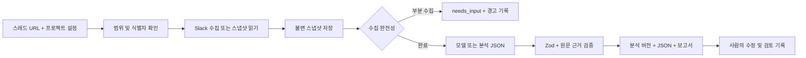

# 아키텍처와 확장 경계

MVP의 목표는 Slack 논의를 원문으로 검증할 수 있는 개발 요구사항으로 바꾸는 것이다. 분석의 완료, 사람의 검토, 코드 실행 권한은 서로 다른 상태다. 현재 구현은 분석과 검토 기록까지 제공한다.

## 처리 흐름

Slack 수집기, 분석 제공자, 검증기, 이력 저장소와 CLI를 분리한다. `--snapshot`과 `--analysis-file`은 외부 서비스를 대체하는 입력 경계이며 운영 경로와 같은 스키마 및 원문 검증을 통과해야 한다.

## 핵심 데이터

| 데이터 | 의미 |
| --- | --- |
| `ThreadSnapshot` | 워크스페이스·채널·루트 메시지, 수집 시각, 완전성, 경고와 내용 해시를 포함한다. |
| `MessageVersion` | Slack timestamp를 문자열로 보존하며 텍스트·수정 시각·작성자·원문 링크를 고정한다. |
| 요구사항 | 논의 상태, 원문 근거, 대체하는 요구사항, 미해결 질문과 수용 기준을 가진다. |
| 수용 기준 | `source` 또는 `derived`를 명시하여 원문 사실과 제안을 구별한다. |
| 질문 | 구현을 막는 질문인지와 영향을 받는 요구사항을 명시한다. |
| 실행·수정 버전 | 입력 및 설정 식별 정보, 모델·프롬프트 정보, 단계·실패·검토 개입을 보존한다. |

요구사항 상태는 `confirmed`, `proposed`, `open`, `rejected`, `superseded`다. 이 값은 대화의 의미를 표현하며 실행 승인으로 사용하지 않는다. 외부 분석 결과에 검토 상태나 권한 필드가 포함되면 엄격한 스키마가 거부한다.

## 원문 검증

`sourceRefs`는 링크 문자열 대신 `messageVersionId`와 인용문을 저장한다. 검증기는 ID가 현재 스냅샷에 존재하는지, 인용문이 해당 메시지의 실제 부분 문자열인지 확인한다. 링크는 검증된 메시지에서 가져온다. 요구사항·질문·수용 기준의 ID는 고유해야 하며, 참조 관계도 검증한다.

이 방식은 존재하지 않는 인용이나 원문 바꿔치기를 탐지한다. 원문에서 그 결론이 논리적으로 성립하는지까지 기계적으로 증명하지는 않는다. 사람이 원문과 요구사항을 함께 검토할 수 있도록 보고서를 생성한다.

삭제된 메시지와 접근 불가능한 과거 데이터는 복원할 수 없다. 수집 당시 접근 가능한 결과를 보존하며 부분 수집 상태에서는 분석을 진행하지 않는다. 파일·첨부의 본문은 수집하지 않고 경고를 남긴다.

## 저장과 재실행

SQLite는 단일 사용자 로컬 CLI의 실행 이력을 담당한다. 스냅샷과 분석 버전을 수정하는 대신 새 레코드를 추가한다. 사람이 수정한 분석도 같은 원문 검증을 거치고 원본과 분리해 저장한다. 단계별 상태와 실패 원인을 남겨 완료되지 않은 실행을 성공처럼 보이지 않게 한다.

재사용 키는 내용과 분석 설정을 식별한다. 완료된 동일 입력은 재사용하고, 메시지나 분석 설정이 바뀌거나 `--force`가 지정되면 새 실행을 만든다. 재사용은 당시 스냅샷 기준이며 Slack 상태가 영원히 같다는 보장이 아니다. 실시간 명령은 다시 수집해 변경을 확인한다.

SQLite와 JSON·Markdown 파일은 서로 다른 저장 매체다. 전체 실행을 하나의 분산 트랜잭션으로 취급하지 않는다. 아티팩트 쓰기 실패는 실행 실패로 남기며, DB 이력과 원본 스냅샷을 이용해 원인을 확인한다. 실행 데이터는 Git에 커밋하지 않는다.

## 권한과 신뢰 경계

- 프로젝트 설정의 워크스페이스 및 채널 목록이 수집 범위를 제한한다.
- Slack과 모델 인증 정보는 환경 변수로 주입하고 결과에 포함하지 않는다.
- Slack 메시지는 명령이 아닌 데이터다. 분석 제공자는 대화 속 지시문으로 도구를 실행하지 않는다.
- 로컬 사람 검토는 수정 이력이다. OS 사용자 정보는 기록용이며 강한 신원 검증이 아니다.
- 저장되는 원문은 로컬 평문이다. 조직 환경에서 쓰기 전 보존 정책·암호화·접근 관리의 운영 결정을 별도로 해야 한다.

## `plan` / `implement` 확장

후속 모드는 동일한 원문 근거와 분석 버전을 입력으로 받도록 확장한다. 모델 출력이 곧 실행 지시가 되지 않도록 별도의 승인 객체와 실행 경계를 둔다.

1. `plan`은 검토된 요구사항 버전과 저장소 상태를 고정하고 변경 파일·검증 방법·불확실성을 구조화한다. 미해결 차단 질문과 부분 수집 결과는 실행 가능한 계획으로 승격하지 않는다.
2. `implement`는 특정 계획 버전·저장소 커밋·권한 범위에 연결된 명시적 승인을 요구한다. 원문·계획·커밋이 달라지면 기존 승인을 재사용하지 않는다.
3. 코드 변경은 격리된 브랜치 또는 worktree에서 수행하고 테스트 결과와 diff를 기록한다. 외부 쓰기, 커밋, 푸시, PR 생성은 각각 정책과 실행 기록을 가진다.
4. 장기 실행을 추가할 때 작업 큐·취소·재시도·정리 정책을 정의한다. 현재 CLI의 동기 SQLite 저장소를 다중 사용자 서버 저장소로 그대로 간주하지 않는다.

현재 `plan`과 `implement` 명령은 명시적으로 미지원 처리한다. 자동 코드 작성이나 승인 시스템이 구현된 것으로 표시하지 않는다.

## 검증 전략

테스트는 합성 데이터와 주입한 외부 서비스 대역을 사용한다. 우선순위는 수집 페이지 누락, 메시지 수정에 따른 버전 변경, 허용 범위 이탈, 잘못된 원문 참조, 미해결 질문 관계, 부분 수집 중단, 동일 입력 재사용, 원본을 보존하는 사람 수정, 비밀 값 유출 방지다.

실제 Slack 검증에서는 공개·비공개 채널별 OAuth 권한, 긴 스레드의 페이지 처리, API 제한, 첨부 경고, 수정된 메시지의 재수집, JSON과 보고서의 원문 연결을 확인한다. 실제 모델 검증에서는 정확한 인용과 논의 상태 분류를 사람이 확인한다. 자동 테스트가 통과해도 실제 계정 연결이나 요구사항 해석 품질을 검증한 것으로 간주하지 않는다.

참조: [기준 설계](https://chatgpt.com/space/page_ee5453d201508191b26f17dc9f064f95), [Slack 스레드 API](https://docs.slack.dev/reference/methods/conversations.replies/), [Node.js 24 SQLite API](https://nodejs.org/docs/latest-v24.x/api/sqlite.html).
