# 아키텍처와 확장 경계

Slack 논의를 원문으로 검증할 수 있는 개발 요구사항으로 바꾸고, 사람이 검토한 범위의 계획·코드 변경·검증·Draft PR을 연결한다. 분석의 완료, 사람의 검토, 코드 실행 권한은 서로 다른 상태다. 로컬 CLI와 `serve-slack` Socket Mode 서비스를 제공하며, Slack 명령을 받으면 지정한 스레드를 수집한다. 새 일반 메시지를 상시 수집하는 방식은 아니다.

## 처리 흐름

```mermaid
flowchart LR
  A[스레드 URL + 프로젝트 설정] --> B[범위 및 식별자 확인]
  B --> C[Slack 수집 또는 스냅샷 읽기]
  C --> D[불변 스냅샷 저장]
  D --> E{수집 완전성}
  E -- 부분 수집 --> F[needs_input + 경고 기록]
  E -- 완료 --> G[모델 또는 분석 JSON]
  G --> H[Zod + 원문 근거 검증]
  H --> I[분석 버전 + JSON + 보고서]
  I --> J[사람의 수정 및 검토 기록]
  I --> K[plan: 분석 버전 + 저장소 문맥]
  J --> K
  K --> L[계획 검토 + approve-plan]
  L --> M[implement: 별도 worktree]
  M --> N[Docker 기준 테스트]
  N --> O[허가된 파일 변경]
  O --> P[Docker 변경 후 테스트 + diff]
  P --> Q[로컬 결과]
  P --> R[게시 허가가 있으면 Draft PR]
```

위 그림은 CLI의 검토·계획·승인 흐름이다. Slack에서는 `/duduk analyze`로 요구사항과 계획을 먼저 제안하고, 사람이 `예 · 구현하고 PR 만들기`를 선택하면 표시된 요구사항과 계획을 함께 승인한다. `아니요 · 수정 요청`은 이전 승인 버튼을 무효화하고 피드백 입력창을 연다. 의견을 제출하거나 `feedback` 명령을 실행하면 새 제안을 만들고 다시 승인을 받는다. 수정 요청만으로 구현을 승인하지 않는다.

Slack 수집기, 분석 제공자, 검증기, 이력 저장소와 CLI·Socket Mode 전송 계층을 분리한다. `--snapshot`과 `--analysis-file`은 외부 서비스를 대체하는 입력 경계이며 운영 경로와 같은 스키마 및 원문 검증을 통과해야 한다.

## 핵심 데이터

| 데이터 | 의미 |
| --- | --- |
| `ThreadSnapshot` | 워크스페이스·채널·루트 메시지, 수집 시각, 완전성, 경고와 내용 해시를 포함한다. |
| `MessageVersion` | Slack timestamp를 문자열로 보존하며 텍스트·수정 시각·작성자·원문 링크를 고정한다. |
| 요구사항 | 논의 상태, 원문 근거, 대체하는 요구사항, 미해결 질문과 수용 기준을 가진다. |
| 수용 기준 | `source` 또는 `derived`를 명시하여 원문 사실과 제안을 구별한다. |
| 질문 | 구현을 막는 질문인지와 영향을 받는 요구사항을 명시한다. |
| 실행·수정 버전 | 입력 및 설정 식별 정보, 모델·프롬프트 정보, 단계·실패·검토 개입을 보존한다. |
| 구현 계획 | 분석 버전·선택한 요구사항·저장소 기준 버전과 변경 범위·검증 방법을 연결한다. |
| 실행 허가 | 특정 계획 버전에 대해 허용한 변경·명령·게시 범위를 고정한다. |
| 구현 실행 | 격리 작업 위치, 변경 파일, 테스트 출력, 수용 기준별 검증 상태와 게시 결과를 보존한다. |

요구사항 상태는 `confirmed`, `proposed`, `open`, `rejected`, `superseded`다. 이 값은 대화의 의미를 표현하며 실행 승인으로 사용하지 않는다. 외부 분석 결과에 검토 상태나 권한 필드가 포함되면 엄격한 스키마가 거부한다.

## 원문 검증

`sourceRefs`는 링크 문자열 대신 `messageVersionId`와 인용문을 저장한다. 검증기는 ID가 현재 스냅샷에 존재하는지, 인용문이 해당 메시지의 실제 부분 문자열인지 확인한다. 링크는 검증된 메시지에서 가져온다. 요구사항·질문·수용 기준의 ID는 고유해야 하며, 참조 관계도 검증한다.

이 방식은 존재하지 않는 인용이나 원문 바꿔치기를 탐지한다. 원문에서 그 결론이 논리적으로 성립하는지까지 기계적으로 증명하지는 않는다. 사람이 원문과 요구사항을 함께 검토할 수 있도록 보고서를 생성한다.

삭제된 메시지와 접근 불가능한 과거 데이터는 복원할 수 없다. 수집 당시 접근 가능한 결과를 보존하며 부분 수집 상태에서는 분석을 진행하지 않는다. 파일·첨부의 본문은 수집하지 않고 경고를 남긴다.

## 저장과 재실행

SQLite는 로컬 실행 이력과 Slack 작업 큐·승인·피드백 기록을 담당한다. 스냅샷과 분석 버전을 수정하는 대신 새 레코드를 추가한다. 사람이 수정한 분석도 같은 원문 검증을 거치고 원본과 분리해 저장한다. 단계별 상태와 실패 원인을 남겨 완료되지 않은 실행을 성공처럼 보이지 않게 한다.

재사용 키는 내용과 분석 설정을 식별한다. 완료된 동일 입력은 재사용하고, 메시지나 분석 설정이 바뀌거나 `--force`가 지정되면 새 실행을 만든다. 재사용은 당시 스냅샷 기준이며 Slack 상태가 영원히 같다는 보장이 아니다. 실시간 명령은 다시 수집해 변경을 확인한다.

SQLite와 JSON·Markdown 파일은 서로 다른 저장 매체다. 전체 실행을 하나의 분산 트랜잭션으로 취급하지 않는다. 아티팩트 쓰기 실패는 실행 실패로 남기며, DB 이력과 원본 스냅샷을 이용해 원인을 확인한다. 실행 데이터는 Git에 커밋하지 않는다.

## 권한과 신뢰 경계

- 프로젝트 설정의 워크스페이스 및 채널 목록이 수집 범위를 제한한다.
- Slack과 모델 인증 정보는 환경 변수로 주입하고 결과에 포함하지 않는다.
- Slack 메시지와 저장소 파일은 모델의 입력 데이터다. 모델은 셸 명령을 실행하지 않으며 구조화된 분석·계획·파일 변경을 반환한다.
- 로컬 사람 검토는 수정 이력이다. OS 사용자 정보는 기록용이며 강한 신원 검증이 아니다.
- 계획과 모델 출력에 실행 허가를 실을 수 없다. 실행 허가는 CLI 승인 명령이나 권한을 확인한 Slack 승인 동작이 검증한 범위에 대해 발급한다.
- 테스트는 별도 파일 스냅샷을 사용하는 Docker 컨테이너에서 실행한다. 컨트롤러의 worktree·Git 인증 정보·환경 변수는 테스트에 직접 전달하지 않는다.
- 저장되는 원문은 로컬 평문이다. 조직 환경에서 쓰기 전 보존 정책·암호화·접근 관리의 운영 결정을 별도로 해야 한다.

## 계획·구현의 경계

`plan`은 최신 분석 버전, 선택한 요구사항, 저장소 기준 버전과 허용된 파일 문맥을 고정한다. 모델은 변경할 파일과 작업, 테스트 명령의 식별자, 수용 기준 검증 방법을 반환한다. `--plan-file`도 동일한 검증을 통과해야 한다. 계획 생성 시점에는 사람 검토 전 초안을 사용할 수 있지만, 그 계획을 그대로 실행할 수 있다는 뜻은 아니다.

`approve-plan`은 사람이 수락한 최신 분석 버전인지, 선택한 요구사항이 `confirmed`인지, 선택 범위에 영향을 주는 차단 질문이 남았는지 확인한다. 허가는 특정 계획과 분석·저장소·설정 버전에 연결한다. 원본·계획·기준 커밋이 바뀌면 다시 계획하고 허가해야 한다. `--allow-pr`가 없는 허가는 로컬 변경·검증 범위다.

`implement`는 별도 Git worktree에서 작업한다. 변경 전 테스트가 실패하면 코드 생성 전에 중단한다. 통과하면 모델 또는 `--changes-file`에서 받은 텍스트 파일 변경을 검사하고, 허용된 경로와 크기 범위 안에만 적용한다. 모델이 임의의 셸 명령을 추가할 수 없으며 테스트는 프로젝트 설정에 등록된 명령만 사용한다.

테스트 컨테이너는 미리 준비한 Docker 이미지를 사용하고 네트워크를 차단한다. 실행한 불변 이미지 ID를 변경 전·후 결과에 남기며 두 단계의 이미지가 다르면 검증을 중단한다. 프로젝트 파일의 별도 스냅샷에서 Git 정보·비밀 파일을 제외하며 컨트롤러 worktree를 직접 마운트하지 않는다. 따라서 테스트가 파일을 수정해도 컨트롤러가 검사한 diff를 바꿀 수 없다. 의존성 설치와 이미지 준비는 실행 전 프로젝트 관리자가 수행한다. Docker나 이미지가 준비되지 않으면 호스트 셸로 대체하지 않고 준비 방법을 안내한다.

변경 전·후 명령 결과와 수용 기준별 검증 상태는 각각 기록한다. 자동 명령 통과를 모든 수용 기준의 증명으로 취급하지 않으며, 수동 확인과 미실행 항목을 보고서에 남긴다. 검증 후에는 별도 브랜치에 로컬 커밋을 만들고 diff를 보존한다. 게시 허가와 `--publish`가 함께 있으면 설정한 저장소에 푸시·Draft PR을 만들며 병합·배포는 하지 않는다.

실패한 구현은 저장된 체크포인트와 `--resume`으로 검증·게시를 이어갈 수 있다. 이미 적용한 변경이나 완료한 게시 작업을 중복 실행하지 않도록 이력을 확인한다. 재개가 새 범위의 허가나 실패한 테스트의 통과를 대신하지는 않는다.

CLI·Slack의 유료 `save`·`analyze`·`plan`·`implement`는 같은 `storageDir/budget.sqlite`의 누적 예산을 공유한다. 기본·최대 한도는 $10이며 `development.budgetUsd`로 낮출 수 있다. 호출 전 최대 비용을 예약하고 응답의 사용량으로 추정 비용을 정산한다. 사용량을 확인할 수 없는 실패는 예약액을 보존한다. 네트워크·API·스키마 오류는 자동 재시도하지 않는다. 분석·계획·구현의 일부 로컬 검증 오류는 단계별 한 번만 교정하며, 교정 호출도 같은 예산의 예약 검사를 거친다.

Slack 작업은 프로젝트별로 직렬 처리하며 허용 사용자·승인자·채널·현재 제안 버전을 확인한다. 실행 중 중단된 작업은 `needs_resume`으로 남기고 자동 재실행하지 않는다. 여러 서버에서 운영하려면 현재 로컬 SQLite·프로세스 잠금의 범위를 넘어서는 작업 조정이 필요하다. 사용 방법은 [계획·구현 가이드](plan-implement.md)와 [Slack 명령 가이드](slack-commands.md)에 설명한다.

## 검증 전략

테스트는 합성 데이터와 주입한 외부 서비스 대역을 사용한다. 우선순위는 수집 페이지 누락, 메시지 수정에 따른 버전 변경, 허용 범위 이탈, 잘못된 원문 참조, 미해결 질문 관계, 부분 수집 중단, 동일 입력 재사용, 원본을 보존하는 사람 수정, 비밀 값 유출 방지다. 계획·구현에는 오래된 허가 차단, 경로 이탈, 예산 초과, 기준 테스트 실패, 검증 상태 기록과 체크포인트 재개를 추가한다.

실제 Slack 검증에서는 공개·비공개 채널별 OAuth 권한, 긴 스레드의 페이지 처리, API 제한, 첨부 경고, 수정된 메시지의 재수집, JSON과 보고서의 원문 연결을 확인한다. 실제 모델 검증에서는 정확한 인용과 논의 상태 분류를 사람이 확인한다. 자동 테스트가 통과해도 실제 계정 연결이나 요구사항 해석 품질을 검증한 것으로 간주하지 않는다.

참조: [기준 설계](https://chatgpt.com/space/page_ee5453d201508191b26f17dc9f064f95), [Slack 스레드 API](https://docs.slack.dev/reference/methods/conversations.replies/), [Node.js 24 SQLite API](https://nodejs.org/docs/latest-v24.x/api/sqlite.html).
