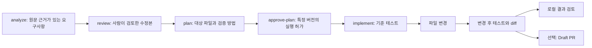

# 계획·구현 사용 가이드

`plan`은 Slack 분석과 저장소 파일을 읽어 변경 계획을 만듭니다. `implement`는 허가된 계획으로 별도 Git worktree의 파일을 수정하고 Docker 안에서 테스트합니다. 옵션을 지정하면 GitHub에 Draft PR까지 만듭니다. 각 단계는 로컬 CLI 또는 Slack Socket Mode 작업 프로세스에서 진행됩니다.



## 1. 대상 프로젝트 준비

CLI 자체와 변경할 애플리케이션은 별도 저장소여도 됩니다. `repoPath`는 **실제로 수정할 애플리케이션의 Git 저장소**입니다. Slack의 워크스페이스·채널 설정으로 이 경로를 추론하지 않습니다. 가계부 Slack에 연결돼 있어도 가계부 코드의 경로와 테스트 환경은 별도로 지정해야 합니다.

필요한 환경은 다음과 같습니다.

- CLI를 실행할 Node.js 24 이상
- 커밋이 있고 작업 상태가 정리된 대상 Git 저장소
- 실행 중인 Docker와 로컬에 준비된 테스트 이미지
- 유료 모델 호출을 사용할 경우 `.env` 또는 환경 변수의 `OPENAI_API_KEY`
- Draft PR을 게시할 경우 GitHub CLI(`gh`) 인증과 대상 remote에 대한 쓰기 권한

[설정 예제](../examples/development-project.json)를 CLI를 실행하는 디렉터리에 복사하고 프로젝트에 맞게 수정합니다.

```sh
cp examples/development-project.json development-project.json
```

`repoPath`와 `storageDir`는 설정 파일이 있는 디렉터리를 기준으로 해석합니다. `development.readPaths`와 `writePaths`는 대상 저장소 루트 기준입니다. 토큰과 API 키는 설정 파일에 넣지 않습니다.

| 설정 | 의미 |
| --- | --- |
| `repoPath` | 계획·구현 대상 Git 저장소 |
| `development.readPaths` | 계획과 코드 생성에 사용할 파일·디렉터리 경로. glob 패턴은 사용하지 않음 |
| `development.writePaths` | 변경을 허용한 파일·디렉터리 경로. 실제 변경 파일은 계획으로 더 제한 |
| `development.commands` | 실행 가능한 검증 명령. `id`, `program`, `args`로 정의 |
| `development.dockerImage` | 미리 준비한 테스트 Docker 이미지 |
| `development.commandTimeoutMs` | 검증 명령의 시간 제한. 기본 120,000ms |
| `development.maxContextBytes` | 모델에 제공할 저장소 문맥의 크기 제한. 기본 98,304바이트 |
| `development.maxFileBytes` | 개별 파일 크기 제한. 기본 32,768바이트 |
| `development.maxFiles` | 읽을 파일 수 제한. 기본 30개 |
| `development.maxChangedFiles` | 한 번에 바꿀 파일 수 제한. 기본 12개 |
| `development.maxChangeBytes` | 파일 변경 결과의 크기 제한. 기본 98,304바이트 |
| `development.budgetUsd` | 같은 저장 경로의 지식 저장·분석·계획·구현 모델 호출이 공유하는 누적 예산 한도. 기본·최대 $10 |
| `github.repository` | PR을 게시할 `owner/repository` |
| `github.baseBranch` | PR 대상 브랜치 |
| `github.remote` | 푸시할 Git remote 이름 |

예제는 외부 의존성이 없는 Node.js 프로젝트의 `node --test`를 가정합니다. 실제 프로젝트의 디렉터리 이름과 테스트 명령으로 변경하세요. 모델은 `commands`에 없는 명령을 추가해서 실행할 수 없습니다.

### Docker 이미지와 의존성

테스트는 네트워크가 차단된 컨테이너에서 실행합니다. 컨테이너 실행 중에 `npm install` 등으로 의존성을 내려받는 방식은 사용할 수 없습니다. 필요한 런타임·도구·의존성을 이미지에 미리 준비합니다.

외부 의존성이 없는 예제라면 실행 전에 이미지를 준비할 수 있습니다.

```sh
docker pull node:24
```

실제 애플리케이션은 그 프로젝트에 맞는 테스트 이미지를 만들어 `dockerImage`에 지정합니다. 컨테이너에서 제공되는 소스 파일 스냅샷과 이미지의 의존성 경로가 맞는지도 먼저 확인하세요. 실행 단계에서 이미지가 없거나 Docker에 연결할 수 없으면 준비 오류로 중단합니다.

검증에는 Git 메타데이터와 비밀 파일을 제외한 별도 스냅샷을 사용합니다. CLI를 실행한 호스트의 인증 정보나 `.env`를 컨테이너에 전달하지 않습니다. 테스트가 변경한 파일을 컨트롤러의 worktree로 가져오지 않습니다.

실제 사용한 불변 Docker 이미지 ID(`sha256:…`)를 변경 전·후 명령 결과의 `imageId`에 기록합니다. 두 단계의 이미지 ID가 다르면 검증을 완료 처리하지 않습니다. 재현성이 필요한 프로젝트는 태그만 사용하기보다 고정한 이미지 digest로 설정하세요.

## 2. 분석을 검토하고 구현 범위 정하기

기존 `analyze` 결과의 `analysis.json`을 복사해 원문과 비교하고 수정합니다. `review`에 넣는 파일은 분석 객체이며 `show`의 전체 출력을 넣는 형식은 아닙니다.

```sh
node dist/cli.js review '<analyzeRunId>' \
  --file reviewed-analysis.json \
  --reason '요구사항, 원문 근거, 수용 기준 검토 완료' \
  --minutes 5 \
  --config development-project.json
```

구현하려는 요구사항은 `confirmed`여야 하며, 그 요구사항에 영향을 주는 차단 질문이 없어야 합니다. `confirmed`는 원래 대화의 결정 상태이고 `review`는 사람이 분석을 수락했다는 기록입니다. 두 조건을 따로 검사합니다.

예를 들어 합성 예제의 `REQ-CSV`는 확정돼 있고, `REQ-TIMEZONE`에는 차단 질문이 남아 있습니다. `--requirements REQ-CSV`로 CSV 범위만 계획할 수 있습니다. 다른 요구사항의 질문이 선택한 범위에도 영향을 준다면 먼저 해결해야 합니다.

## 3. 계획 생성과 확인

```sh
node dist/cli.js plan '<analyzeRunId>' \
  --requirements REQ-CSV \
  --config development-project.json
```

출력된 `planId`와 파일 경로를 보관하고 `plan.json`, `plan.md`를 확인합니다. 계획에는 선택한 요구사항, 변경할 파일과 작업, 검증 명령 및 수용 기준 검증 방법이 담깁니다. 모델에 제공한 저장소 문맥도 결과물에 남습니다. `--requirements`를 생략하면 `rejected`·`superseded`를 제외한 요구사항을 선택하므로, 일부 범위만 구현하려면 ID를 명시합니다.

같은 입력의 계획은 재사용합니다. 새로 생성하려면 `--force`를 사용합니다. `--plan-file <file>`로 구조화된 계획 JSON을 제공하면 모델 API를 호출하지 않고 같은 검증 절차를 적용합니다. 저장된 `plan.json`은 식별 정보와 `plan` 객체를 묶은 결과물이므로 파일 재생에는 그 안의 **`plan` 객체**를 사용합니다.

계획 객체는 `summary`, `items`, `excludedRequirements`를 포함합니다. 각 작업은 요구사항 ID, 현행 동작, 저장소의 실제 코드 인용(`codeRefs`), 변경 내용과 정확한 파일 경로(`affectedPaths`), 의존 작업, 수용 기준별 검증 명령, 차단 사유를 담습니다. 선택한 요구사항과 그 수용 기준을 빠짐없이 한 번씩 연결해야 하며 나머지 요구사항은 제외 목록에 명시합니다. 전체 구조는 [`planSchema`](../src/planning.ts)에 있습니다.

`affectedPaths`는 실제로 수정해야 하는 파일 목록입니다. 구현 결과에서 이 중 한 파일이라도 빠지거나 내용이 그대로이면 거부합니다. 읽기만 한 파일은 `codeRefs`에만 남깁니다. 모델은 코드 근거의 파일·행 범위를 선택하고, 인용문은 프로그램이 원문에서 가져옵니다.

사람 검토 전에도 계획 초안은 만들 수 있습니다. 이후 `review`로 분석 버전이 달라지면 최신 검토 버전으로 다시 `plan`을 실행해야 합니다. 이전 계획에 새 검토 결과를 암묵적으로 덧씌우지 않습니다.

## 4. 계획에 실행 허가 부여

검토한 계획의 파일 범위와 검증 방법을 허가합니다.

```sh
node dist/cli.js approve-plan '<planId>' \
  --reason '변경 파일과 검증 방법을 확인함' \
  --config development-project.json
```

결과의 `grantId`가 구현 실행에 필요합니다. `--actor <name>`으로 기록할 검토자 이름을 지정할 수 있습니다. 이 로컬 기록은 로그인 인증이나 전자 서명이 아닙니다.

허가는 해당 계획과 분석·저장소·설정 버전에 연결됩니다. 오래된 계획이나 허가로 최신 내용을 실행할 수 없습니다. 기준이 바뀌었다면 계획을 다시 생성하고 검토합니다.

Draft PR까지 게시하려면 허가 시점에 `--allow-pr`를 추가합니다.

```sh
node dist/cli.js approve-plan '<planId>' \
  --reason '파일 변경, 테스트와 Draft PR 게시 범위 확인' \
  --allow-pr \
  --config development-project.json
```

`--allow-pr`만으로 PR을 즉시 만들지는 않습니다. 구현 실행에도 `--publish`를 지정해야 합니다.

## 5. 코드 변경과 검증

```sh
node dist/cli.js implement '<planId>' \
  --grant '<grantId>' \
  --config development-project.json
```

실행 과정은 다음과 같습니다.

1. 계획·허가·현재 분석과 저장소 상태를 확인합니다.
2. 대상 저장소의 별도 worktree를 준비합니다.
3. Docker 안에서 변경 전 기준 테스트를 실행합니다. 실패하면 코드 생성 전에 중단합니다.
4. 모델이 반환한 구조화된 텍스트 파일 변경을 검사하고 허가된 경로에 적용합니다.
5. 별도 스냅샷의 Docker 환경에서 변경 후 테스트를 실행합니다.
6. 별도 브랜치에 로컬 커밋을 만들고 diff, 검증 결과, 수용 기준별 상태와 보고서를 저장합니다.

`--changes-file <file>`을 지정하면 모델 대신 구조화된 파일 변경 JSON을 사용합니다. 경로·크기·허가 범위 검사는 그대로 적용됩니다. `files[].content`는 변경 후 파일 전체 텍스트이고 `null`은 기존 파일 삭제를 뜻합니다. 파일 경로는 계획의 `affectedPaths`에 정확히 포함돼야 합니다. 임의 셸 스크립트를 받아 실행하는 옵션은 아닙니다.

```json
{
  "summary": "CSV 값의 쉼표를 이스케이프한다.",
  "files": [
    {
      "path": "src/csv.js",
      "content": "export const csvCell = value => '\"' + String(value).replaceAll('\"', '\"\"') + '\"';\n"
    }
  ]
}
```

위 형식 예제는 해당 파일이 실제 계획에 포함됐다는 뜻은 아닙니다. 프로젝트 계획과 저장소 문맥에 맞는 내용을 제공해야 합니다.

수용 기준별 보고서를 확인하세요. 자동 테스트가 통과해도 사용자 경험이나 요구사항의 의미를 전부 검증한 것은 아닙니다. 검증 명령을 연결하지 않은 항목은 `not_run (manual review required)`로 남으며 통과로 취급하지 않습니다.

### Draft PR 게시

게시 권한이 있는 `grantId`로 실행하며 `--publish`를 추가합니다.

```sh
node dist/cli.js implement '<planId>' \
  --grant '<grantId>' \
  --publish \
  --config development-project.json
```

검증 후 설정한 remote로 커밋을 푸시하고 `github.repository`에 Draft PR을 생성합니다. PR에는 요구사항 ID와 검증 결과를 남기며, 상세 Slack 원문 근거는 로컬 보고서에서 확인합니다. 실제 게시 성공은 실행 결과의 `prUrl`과 `publish` 단계에서 확인합니다. 이 도구는 PR을 병합하거나 배포하지 않습니다.

## 6. 중단된 실행 이어가기

실행이 중단되면 먼저 구현 보고서와 실행 이력에서 실패 단계와 저장된 결과를 확인합니다. 재개할 때는 새 구현을 만드는 대신 원래 `implementationRunId`를 사용합니다.

```sh
node dist/cli.js implement '<planId>' \
  --grant '<grantId>' \
  --resume '<implementationRunId>' \
  --config development-project.json
```

게시까지 이어가려면 `--publish`를 함께 지정합니다. 저장된 체크포인트에서 검증·게시를 이어가며 이미 적용한 코드 변경을 다시 적용하지 않습니다. 같은 허가로 별도 실행을 시작하려고 하면 기존 실행 ID로 재개하도록 안내합니다. 이미 로컬 구현이 완료된 실행도 게시 권한이 있는 허가라면 재개해 PR을 만들 수 있습니다.

재개 시에도 계획과 허가의 유효성, 기록한 diff와 worktree의 일치를 확인합니다. 테스트 환경이나 인증 오류는 원인을 해결하고 재개할 수 있습니다. 생성된 코드의 오류를 해결하려고 worktree를 직접 수정하면 체크포인트와 달라져 재개가 거부됩니다. 코드 변경이 필요한 경우 계획·변경 내용을 검토하고 새 허가로 실행하세요.

## 비용과 호출 제한

CLI·Slack의 유료 작업은 기본적으로 `gpt-4.1-mini`를 사용합니다. `development.implementationModel`을 `gpt-4.1`로 지정하면 코드 생성·교정만 해당 모델을 사용하며, 분석·계획과 같은 예산 장부를 유지합니다. 호출 전 모델의 전체 입력 한도와 출력 상한을 기준으로 mini는 약 $0.4322, GPT-4.1은 약 $2.1607를 보수적으로 예약하고 `budget.sqlite`에 저장합니다. 이는 실제 호출 비용이 아닙니다. 응답을 받은 뒤 실제 모델의 토큰 사용량과 가격으로 정산합니다. 누적 예산은 기본·최대 $10이며 `development.budgetUsd`로 더 작은 한도를 지정할 수 있습니다. 예산을 예약할 수 없으면 호출 전에 중단합니다. 네트워크·API·스키마 오류는 자동 재시도하지 않습니다. 일부 모델 출력의 로컬 검증 오류는 분석·계획·구현 단계별 한 번만 교정하며, 추가 호출도 같은 예산의 예약 검사를 거칩니다.

```sh
node dist/cli.js budget --config development-project.json
```

`reservedOrSpentUsd`는 확정된 추정액과 사용량을 모르는 예약액의 합계이며 `limitUsd`는 설정 한도, `requests`는 예약한 호출 수입니다. 같은 `storageDir`를 쓰는 지식 저장·분석·계획·구현 호출과 교정 호출이 이 누적액을 공유합니다.

모델이 반환한 토큰 사용량으로 추정 비용을 기록합니다. 실패 응답에 사용량이 없으면 실제 비용을 0으로 단정하지 않고 예약액을 보존합니다. 결과의 추정 비용은 OpenAI 청구서와 동일한 값이라는 보장이 없습니다.

이 예산 제한은 **이 도구의 CLI·Slack 유료 모델 호출에 적용**됩니다. 다른 애플리케이션의 API 사용량이나 OpenAI 계정 전체의 청구액을 제한하지 않습니다. 예산 기록을 삭제하거나 다른 저장 경로를 사용하면 기존 누적 이력을 이어받지 못하므로, 한도를 유지하려면 같은 저장 경로를 사용하세요.

`--plan-file`과 `--changes-file`은 각각 해당 모델 호출을 대체합니다. Docker 검증이나 GitHub 게시를 생략하는 옵션은 아닙니다.

## 결과물과 실행 이력

| 결과물 | 내용 |
| --- | --- |
| `plan.json` | 검증한 구조화 계획과 버전 연결 정보 |
| `plan.md` | 사람이 검토할 계획 |
| `context.json` | 계획·구현에 사용한 저장소 문맥 |
| `changes.json` | 적용 대상으로 검증한 파일 변경 |
| `patch.diff` | worktree의 코드 변경 |
| `baseline.json` | 변경 전 명령 결과·출력·Docker 이미지 ID |
| `verification.json` | 변경 후 명령 결과·출력·Docker 이미지 ID |
| `report.md` | 구현·테스트·게시 결과와 남은 확인 사항 |
| `history.sqlite` | 분석, 검토, 계획, 허가와 구현 실행 이력 |
| `budget.sqlite` | 유료 호출의 예산 예약과 사용량 기반 비용 기록 |

파일의 존재만으로 성공을 판단하지 않습니다. 실패한 실행에도 진단용 결과물이 남을 수 있습니다. 실행 상태와 검증 보고서를 함께 확인하세요. 저장소 문맥과 결과물에는 애플리케이션 코드와 Slack 원문이 포함될 수 있으므로 `storageDir`를 Git에서 제외합니다.

실행별 결과는 `storageDir/runs/<runId>/`, 허가는 `storageDir/grants/<grantId>.json`, 작업 사본은 `storageDir/worktrees/<runId>/`에 저장합니다. 구현 브랜치는 `slack-dev/<runId>`입니다. 계획의 `planId`와 그 실행의 `runId`는 서로 다른 ID입니다. `history`에는 모드별 실행이 함께 표시되며 `show <runId>`에서 세부 이력을 확인합니다. `plan` 완료 상태는 `needs_input`, 허가 후 계획은 `ready`, 구현 완료 상태는 `review_ready`입니다. `review_ready`는 사람이 diff와 미검증 항목을 검토할 차례라는 뜻입니다.

## 재현 가능한 스모크 테스트

[`scripts/smoke-development.mjs`](../scripts/smoke-development.mjs)는 합성 한국어 대화와 의존성이 없는 작은 Git 저장소를 만듭니다. 영어 인사 함수를 한국어로 바꾸는 요구사항을 사용해 분석 재생·검토·계획·허가·구현·Docker 테스트·로컬 커밋을 연결합니다. 검토와 허가도 합성 데이터에 한해서 생성하며 실제 프로젝트의 요구사항을 승인하지 않습니다.

Node.js 24와 실행 중인 Docker가 필요합니다. 먼저 테스트 이미지를 명시적으로 준비합니다.

```sh
docker pull node:24-alpine
npm run smoke:development
```

기본 실행은 계획과 코드 변경을 고정 JSON으로 재생하므로 모델 API 키와 호출 비용이 필요 없습니다. 기준 테스트와 변경 후 테스트는 실제 Docker에서 실행합니다. 생성된 테스트와 별도로 두 이름의 인사 결과를 검사하고, API 키 없는 새 CLI 프로세스에서 같은 실행을 재개해 커밋이 중복 생성되지 않는지도 확인합니다.

모델의 계획·코드 생성을 함께 확인하려면 `.env`나 환경 변수에 `OPENAI_API_KEY`를 설정한 뒤 실행합니다.

```sh
npm run smoke:development -- --live
```

이 모드는 `gpt-4.1-mini`를 계획·구현에 각 한 번 호출합니다. 모델 결과의 일부 로컬 검증 오류는 단계별 한 번만 교정할 수 있어 최대 네 번 호출하며, 매 호출은 같은 $0.90 예산의 예약 검사를 거칩니다. API·스키마 오류는 재시도하지 않습니다. 이 금액은 상한이고 실제 비용은 반환된 토큰 사용량으로 추정합니다. 두 모드 모두 Slack API를 호출하거나 GitHub에 푸시·PR을 만들지 않습니다.

매번 `.slack-dev/development-smoke-<임의 값>/`에 독립적인 합성 저장소와 이력을 만들고, 마지막 출력의 `resultPath`에 `result.json`을 저장합니다. 결과에는 실행 ID, worktree·보고서 경로, 독립 검사와 CLI 재개 결과, 예산 기록이 있습니다. **반복 실행마다 새 예산 장부를 사용하므로 $0.90은 테스트 한 번의 한도**이며 여러 번 실행한 비용을 합쳐 제한하는 값은 아닙니다.

## 자주 만나는 중단 원인

| 상황 | 다음 작업 |
| --- | --- |
| 사람 검토가 없거나 선택한 요구사항이 미확정 | 분석을 검토하고 선택 범위의 결정을 확정한 뒤 다시 계획 |
| 선택한 요구사항에 차단 질문이 남음 | 질문에 대한 결정을 원문·검토 결과에 반영 |
| 계획 후 분석·저장소·설정이 바뀜 | 최신 기준으로 계획을 다시 생성하고 허가 |
| Docker 또는 이미지 준비 안 됨 | Docker를 시작하고 설정한 이미지를 로컬에 준비 |
| 기준 테스트 실패 | 대상 프로젝트의 기존 실패를 해결하고 새로운 기준으로 계획 |
| 변경 후 테스트 실패 | 환경 문제는 해결 후 재개. 코드 수정이 필요하면 변경 내용을 검토하고 새 허가로 실행 |
| 유료 호출 예산 부족 | 예약·사용 이력을 확인하고 예산 내에서 범위 조정 |
| PR 권한·remote·인증 오류 | `github` 설정과 `gh` 인증, remote 쓰기 권한을 확인한 뒤 재개 |
