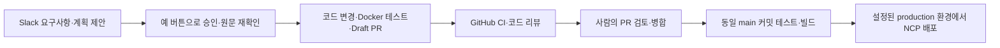

# Slack 명령어 연결 가이드

팀원과 평소처럼 Slack 스레드에서 대화한 뒤 `/duduk analyze`에 그 링크를 넘깁니다. 봇이 요구사항과 현재 코드의 변경·영향을 정리하고, 사람이 **예 · 구현하고 PR 만들기**를 한 번 누르면 코드 변경·Docker 테스트·GitHub Draft PR 생성으로 이어집니다. 요구사항 문서나 별도 입력 양식을 준비할 필요는 없습니다. `/duduk save`는 대화의 도메인 지식을 저장할 때 사용합니다.

명령어를 사용하려면 아래의 Slack 앱·토큰·프로젝트 설정을 마치고 로컬 작업 프로세스를 실행해야 합니다.

## 1. Slack 앱 설치

공개 채널용 [앱 매니페스트](../examples/slack-app-manifest.json)를 사용합니다. 기존 앱을 유지할 때는 앱 설정의 매니페스트에 변경 사항을 반영합니다. 필드 정의는 [Slack 매니페스트 문서](https://docs.slack.dev/reference/app-manifest/)에 있습니다.

1. Slack 앱 관리 화면에서 대상 앱과 워크스페이스를 확인합니다.
2. 매니페스트를 반영해 `/duduk` 명령어, Interactivity, Socket Mode를 활성화합니다.
3. Bot Token Scopes에 `channels:history`, `chat:write`, `commands`가 있는지 확인합니다.
4. 권한이 달라졌다면 앱을 대상 워크스페이스에 **재설치**합니다. 기존 읽기 전용 토큰에 권한이 저절로 추가되지는 않습니다.
5. 앱을 사용할 채널에 추가합니다. 설정의 `slack.channelIds`에도 해당 채널 ID를 넣습니다.
6. Basic Information의 App-Level Tokens에서 `connections:write` 권한을 가진 앱 수준 토큰을 발급합니다.

이 구성은 Socket Mode의 WebSocket 연결을 사용하므로 공개 HTTP 서버·터널·Request URL이 필요하지 않습니다. 사용자 정의 명령어를 사용하려면 Slack 워크스페이스의 앱 설치 정책을 충족해야 합니다. 앱 수준 토큰의 권한은 채널을 읽는 OAuth 권한과 별개입니다. [Socket Mode 문서](https://docs.slack.dev/apis/events-api/using-socket-mode/)

비공개 채널은 이 매니페스트의 기본 범위에 포함하지 않습니다. 비공개 채널을 사용하려면 별도로 필요한 읽기 권한과 채널 접근을 설정하고 작은 스레드에서 수집을 확인하세요.

## 2. 토큰 설정

CLI를 실행할 디렉터리에서 `.env.example`을 `.env`로 복사하고 값을 입력합니다. 설정 JSON·Slack 메시지·Git에는 토큰을 넣지 않습니다.

```sh
# CLI 저장소의 로컬 경로로 이동합니다. duduk 애플리케이션 저장소와 구분합니다.
cd /absolute/path/to/slack-dev-assistant
cp -n .env.example .env
chmod 600 .env
```

기존 `.env`가 있으면 그대로 편집해 누락된 값만 추가합니다. 이 작업 환경의 CLI 체크아웃은 `work/slack-dev-assistant`이며 그 디렉터리에서 실행하면 같은 디렉터리의 `.env`를 읽습니다. **`--config` 파일 옆의 `.env`를 자동으로 찾아 읽는 방식이 아닙니다.** 설정 파일의 `storageDir`·`repoPath`는 설정 파일 기준이고, `.env`는 명령을 실행하는 현재 작업 디렉터리 기준입니다.

| 환경 변수 | 용도 |
| --- | --- |
| `SLACK_APP_TOKEN` | `xapp-`로 시작하는 앱 수준 토큰. Socket Mode 연결에 사용하며 `connections:write`가 필요합니다. |
| `SLACK_BOT_TOKEN` | `xoxb-`로 시작하는 봇 OAuth 토큰. Slack 결과 메시지·버튼·모달을 보내는 데 사용합니다. |
| `SLACK_TOKEN` | 스레드 수집용 OAuth 토큰. 기존에 검증한 읽기 토큰을 유지할 수 있습니다. 봇 토큰과 읽기 토큰은 같은 워크스페이스여야 합니다. |
| `OPENAI_API_KEY` | 지식 추출·요구사항 분석·계획·코드 생성의 모델 호출에 사용합니다. |

`SLACK_APP_TOKEN`과 `SLACK_BOT_TOKEN`은 서로 대체할 수 없습니다. Slack 토큰만으로 OpenAI 모델 호출 비용이 결제되지는 않습니다. 모델 API 비용은 설정한 OpenAI 프로젝트에서 발생합니다.

## 3. 프로젝트와 사용자 지정

기존 프로젝트 설정에 다음 `slackApp` 항목을 추가합니다. 예시 ID는 실제 값으로 바꿉니다.

```json
{
  "slack": {
    "workspace": "your-workspace",
    "channelIds": ["C0123456789"]
  },
  "slackApp": {
    "teamId": "T0123456789",
    "appId": "A0123456789",
    "command": "/duduk",
    "allowedUserIds": ["U0123456789", "U9876543210"],
    "approverUserIds": ["U0123456789"]
  }
}
```

위 조각은 완전한 프로젝트 설정이 아닙니다. 기존 `projectId`, `storageDir`, `model`을 유지하고, 구현하려면 `repoPath`, `development`, `github`도 준비해야 합니다. [계획·구현 설정](plan-implement.md)을 참고하세요.

- `teamId`, `appId`: 요청을 받아들일 Slack 워크스페이스와 앱입니다. 토큰이 아니라 공개 식별자입니다.
- `allowedUserIds`: 명령어 사용을 허용할 사람입니다. 표시 이름이 아닌 Slack 사용자 ID를 넣습니다.
- `approverUserIds`: 요구사항 검토·구현 승인을 허용할 사람입니다. 명령어 사용자 목록에도 포함합니다.
- `slack.channelIds`: 명령과 스레드 원문을 허용할 채널입니다. 다른 채널의 스레드 URL은 받지 않습니다.

Slack에서 저장소 경로나 테스트 명령을 임의로 지정하지 않습니다. 수정 대상과 실행 범위는 로컬 프로젝트 설정에서 정합니다. `github.repository`가 `oy-ubs4939/duduk`이면 그 저장소에 PR을 게시합니다.

## 4. 로컬 작업 프로세스 실행

```sh
npm ci
npm run build
node dist/cli.js doctor --config slack-dev.config.json
node dist/cli.js serve-slack --config slack-dev.config.json
```

이 터미널 프로세스를 실행한 채로 둡니다. Mac이 꺼지거나 잠자기에 들어가 연결이 끊어지면 요청을 처리할 수 없습니다. 항상 사용하려면 별도의 상시 실행 환경이 필요합니다. `doctor`는 읽기 토큰의 인증 확인이며, Socket Mode·응답 권한·실제 채널 접근 전체를 증명하는 검사는 아닙니다.

WebSocket은 명령어·버튼·수정 의견 제출을 받는 연결입니다. 대화 내용은 `save`·`analyze`·수정 요청 처리와 승인 전 확인 시 수집하며, 새 Slack 글을 실시간으로 지식 DB에 동기화하지 않습니다. 이 앱의 결과 메시지는 수집에서 제외합니다. 사람이 제출한 수정 의견은 앱이 원래 스레드에 기록하고, 전송 기록과 실제 메시지가 일치할 때만 원문 근거에 포함합니다. 다른 봇이 남긴 메시지는 일반 원문으로 보존합니다.

요청을 받으면 먼저 접수를 알리고 시간이 걸리는 분석과 개발을 이어서 처리합니다. 작업 ID는 결과와 상태 조회에 사용합니다. Slack의 명령어 요청은 짧은 시간 안에 응답해야 하므로 장시간 모델 호출을 접수 응답 전에 기다리지 않습니다. [Slash command 문서](https://docs.slack.dev/interactivity/implementing-slash-commands/)

## 5. 지식 저장

같은 채널의 스레드 링크를 복사해 **채널의 기본 입력창**에서 실행합니다.

```text
/duduk save https://your-workspace.slack.com/archives/C0123456789/p1795046400000001
```

스레드를 수집하고 도메인 지식을 추출한 뒤, 원문에 실제로 존재하는 인용과 연결해 SQLite에 저장합니다. 지식 항목·관계·근거를 나누어 보존하므로 단순한 요약 문서와 달리 원문으로 추적할 수 있습니다. 저장된 지식은 `unreviewed` 상태의 추출 결과이며, 내용이 옳다고 승인하거나 구현을 허가한 기록이 아닙니다.

용어·엔티티·규칙·사실·결정에 종류와 정규화 키를 부여합니다. `stated`는 원문에 명시됐다는 뜻이고, 제안·불확실한 내용은 `uncertain`으로 보존합니다. 같은 종류·키의 현재 항목에 다른 주장이 있으면 `conflicting`으로 표시해 두 원문을 남깁니다. 이는 충돌 후보 표시이며 모든 의미적 모순을 판정하는 기능은 아닙니다.

완료된 동일 입력은 모델을 다시 호출하지 않고 재사용합니다. 원문이 바뀌면 새 스냅샷·추출 기록을 만들며 이전 버전도 보존합니다. 검색에는 프로젝트·워크스페이스·허용 채널이 일치하는 각 스레드의 최신 수집본만 사용합니다. 내용이 바뀐 새 수집본이 불완전하거나 추출이 실패하면 이전 항목을 최신 정보로 노출하지 않습니다.

뒤의 `analyze`는 **같은 채널의 현재 지식 중 최대 20개·32 KiB**를 참고합니다. 항목의 제목·주장·상태·원문 인용만 전달하며 관계 전체나 저장된 모든 미해결 사항을 불러오지는 않습니다. 참고한 고정 사본은 분석의 `knowledge-context.json`으로 남고 분석 캐시에도 반영됩니다. 현재 요구사항의 근거는 여전히 현재 스레드에서 인용해야 하며, 저장된 지식을 확정 사실이나 구현 승인으로 취급하지 않습니다.

로컬에서도 저장·조회할 수 있습니다.

```sh
node dist/cli.js save '<스레드 URL>' --config slack-dev.config.json
node dist/cli.js knowledge '급여' --limit 20 --config slack-dev.config.json

# 네트워크와 모델 호출을 대체하는 파일 입력
node dist/cli.js save '<스레드 URL>' \
  --snapshot snapshot.json --knowledge-file knowledge.json \
  --config slack-dev.config.json
```

파일 입력도 스키마와 원문 근거 검사를 통과해야 합니다. 지식 저장소에는 Slack 대화가 포함되므로 `storageDir`를 Git에서 제외합니다.

| `storageDir` 아래 파일 | 역할 |
| --- | --- |
| `knowledge.sqlite` | 프로젝트·스레드·스냅샷·메시지 버전, 추출 실행, 지식 항목·관계·원문 근거·미해결 사항을 별도 테이블로 저장 |
| `history.sqlite` | 분석·검토 버전, 계획·기준 커밋, 실행 허가, 구현·검증 체크포인트와 오류 |
| `slack-jobs.sqlite` | Slack 요청·작업 상태·입출력, 승인 동작의 내용 해시·일회용 식별자, 작업자 잠금 |
| `feedback.sqlite` | 수정 의견·작성자·이전 제안 버전·전송 결과와 원문 메시지 연결 |
| `budget.sqlite` | 모델 호출 전 예약액, 확인된 토큰 사용량·추정 비용과 요청 ID |

지식 결과물은 `knowledge/<knowledgeSetId>/`, 분석·계획·구현 결과물은 `runs/<runId>/`에 저장합니다. DB 파일은 로컬 전용 권한으로 만들며 Slack 토큰·API 키를 기록하지 않습니다. 원문에 사용자가 쓴 민감 정보까지 암호화하거나 자동 제거하는 저장소는 아니므로 원문 접근 권한을 가진 사람만 저장 경로를 다루어야 합니다.

## 6. 요구사항 분석부터 PR까지

예를 들어 팀원들이 “달력에서 어느 날짜를 눌렀는지 잘 모르겠어”, “누른 칸에 배경이 있으면 좋겠다”, “색은 아직 정하지 않았어”라고 이야기한 스레드도 입력으로 사용할 수 있습니다. 대화를 요구사항 형식으로 고쳐 쓰지 않고 원래 링크를 전달합니다.

```text
/duduk analyze https://your-workspace.slack.com/archives/C0123456789/p1795046400000001
```

1. 스레드를 수집하고 요구사항·완료 조건·질문을 분석한 뒤 대상 저장소의 구현 계획을 만듭니다.
2. 제목·요약·기능 구현·사이드 이펙트·변경 파일·검증 방법을 한 제안으로 표시합니다. 원문 근거와 실제 코드 인용도 함께 확인합니다. 코드 근거가 없는 영향은 “없음”으로 단정하지 않습니다.
3. 허용된 승인자가 **예 · 구현하고 PR 만들기**를 한 번 누르면 표시한 요구사항과 계획을 함께 승인합니다. `rejected`·`superseded`는 승인 범위에서 제외합니다. 일부 기능을 빼려면 먼저 수정 의견을 제출합니다.
4. 원문을 다시 수집해 제안 당시 내용이 유지됐는지 확인하고, 분석·계획·저장소·설정 버전도 검사합니다. 승인한 계획을 새 모델 응답으로 바꾸지 않습니다.
5. 별도 Git worktree에서 변경 전 테스트, 코드 수정, 변경 후 Docker 테스트를 수행합니다.
6. 성공한 변경을 별도 브랜치에 커밋·푸시하고 GitHub Draft PR 링크를 Slack에 전달합니다.

모델이 요구사항과 미정 사항을 추출하고, 인용 검증기는 근거가 원문에 있는지 확인합니다. 사람은 기능 설명·사이드 이펙트·남은 질문이 대화 의도에 맞는지 검토합니다. 예시 대화의 색상처럼 미정인 내용을 질문으로 제시하면 수정 의견으로 답하고 새 제안을 확인합니다.

`analyze`는 제안까지만 만듭니다. 스레드에 “예”나 “승인”이라고 쓰는 것만으로 구현을 시작하지 않습니다. 승인 권한이 있는 사람은 요청자와 달라도 됩니다. 차단 질문이 남았거나 제안 전체를 Slack에 표시할 수 없으면 예 버튼을 제공하지 않습니다.

**아니요 · 수정 요청**을 누르면 이전 예 버튼을 즉시 무효화하고 수정 의견 입력창을 엽니다. 입력창을 닫아도 이전 승인은 복원되지 않으며, 의견을 제출하기 전에는 재분석하지 않습니다. 같은 채널의 기본 입력창에서 다음 명령으로 의견을 보낼 수도 있습니다.

```text
/duduk feedback <작업 ID> <수정 의견 또는 차단 질문의 답변>
```

수정 의견은 1~3,000자이며 승인 권한이 있는 사용자만 제출할 수 있습니다. 의견을 원래 스레드에 남긴 뒤 새 원문 스냅샷과 분석·계획을 만듭니다. 이전 제안과 의견은 별도로 보존하며, 새 제안에는 새 승인이 필요합니다. 의견 전송 여부가 불명확하면 중복 게시나 모델 재호출을 자동으로 반복하지 않습니다.

승인 전에 사람이 원문을 수정하거나 답글을 추가했다면 기존 제안으로 실행할 수 없습니다. 최신 스레드로 다시 `analyze`한 뒤 검토합니다. 테스트 실패는 성공으로 처리하지 않으며 자동 병합·배포로 넘어가지 않습니다. Slack에 공유된 결과와 수정 의견은 허용 채널의 참여자가 볼 수 있으므로 비밀 값을 적지 않습니다.

로컬 CLI의 `review → plan → approve-plan → implement`는 별도 명령으로 유지합니다. Slack의 예 버튼은 표시한 요구사항 수락과 그 계획의 실행 허가를 함께 기록하는 통합 승인입니다. 기존 방식으로 생성한 대기 작업은 기존 검토·계획 승인 화면을 유지합니다.

진행 상태를 확인합니다.

```text
/duduk status <작업 ID>
```

## 7. 병합·배포 범위

Slack 도구의 실행 범위는 **테스트를 통과한 Draft PR**까지입니다. 그 뒤는 `duduk` 저장소의 별도 CI·배포 단계입니다.



이 연결을 위한 변경은 [duduk PR #1](https://github.com/oy-ubs4939/duduk/pull/1)에서 검토 중입니다. [duduk의 `docs/slack-deployment.md`](https://github.com/oy-ubs4939/duduk/blob/slack-dev/duduk-connection-20261119/docs/slack-deployment.md)에 워크플로, 필수 검사·사람 리뷰 정책, `production` 환경과 NCP 비밀값, 활성화 변수, 실패 복구를 정리했습니다. PR 병합과 해당 설정을 마쳐야 실제 배포가 동작합니다. 운영 서버 접속이나 배포를 수행했다는 의미는 아닙니다.

Slack의 **구현·PR 생성 승인**은 병합·운영 배포 승인을 포함하지 않습니다. 사람이 검토한 PR을 병합한 후, 저장소 설정에 따라 같은 `main` 커밋의 검증된 산출물을 배포합니다. 별도의 배포 승인을 원하면 GitHub `production` 환경의 승인자를 설정합니다.

실제 운영 연결 전에 다음 순서로 확인합니다.

- 허용 사용자·앱·채널과 다른 요청이 거부되는지 확인합니다.
- 작은 테스트 스레드로 `save`의 원문 링크와 `analyze`의 요구사항을 확인합니다.
- 통합 제안을 예로 승인한 후 테스트용 변경으로 Draft PR까지 확인합니다. 아니요와 수정 의견 제출 시 이전 승인이 무효화되는지도 확인합니다.
- 저장소에서 리뷰·병합·배포 정책을 별도로 확인합니다.

자동 테스트 결과와 실제 Slack 앱 연결 여부는 별도로 기록해야 합니다. 모델·Slack 호출을 대체한 테스트가 통과했다는 사실만으로 토큰 설치나 운영 배포까지 완료되었다고 판단하지 않습니다.

## 8. 비용과 실패 복구

현재 유료 `save`·`analyze`·`plan`·`implement`는 `gpt-4.1-mini`를 사용하고 **같은 `storageDir/budget.sqlite`에 기록된 누적 비용**을 함께 제한합니다. 기본 한도는 $10이며 `development.budgetUsd`로 더 낮게 지정할 수 있습니다. `save`·`analyze`만 사용할 때는 `development` 설정이 없어도 기본 한도를 적용합니다.

```sh
node dist/cli.js budget --config slack-dev.config.json
```

호출 전에 최대 비용을 예약하고 사용량을 확인하면 추정 비용으로 정산합니다. 응답이나 사용량이 불명확하면 예약액을 유지합니다. 한도를 넘을 수 있는 다음 호출은 보내지 않습니다. 이 제한은 해당 예산 DB에 기록된 호출에만 적용하며 이전 별도 테스트, 다른 프로그램·저장 경로의 사용료, OpenAI 계정 전체 사용액을 자동으로 합산하거나 제한하지 않습니다. `--force`로 재분석하면 새 호출 비용이 생길 수 있습니다.

| 상태·상황 | 확인과 복구 |
| --- | --- |
| 결과 전송 실패 | 모델·개발 작업 결과는 DB에 남습니다. `/duduk status <작업 ID>`로 확인합니다. 알림 재전송을 위해 모델 호출이나 PR 생성을 반복하지 않습니다. |
| `awaiting_feedback` | 아니요를 눌러 기존 승인이 무효화된 상태입니다. 수정 의견 입력창 또는 `feedback` 명령으로 의견을 제출합니다. |
| `failed` | Slack 상태 메시지와 로컬 실행의 오류를 확인합니다. 소스·권한·차단 질문·예산 문제를 해결한 뒤 필요한 단계만 다시 요청합니다. |
| `needs_resume` | 작업자 중단 또는 구현 중 실패로 자동 재실행을 멈춘 상태입니다. 저장된 구현 실행·허가·커밋·PR을 먼저 확인합니다. 기존 구현 체크포인트가 있으면 아래 로컬 명령으로 이어갑니다. |
| 지식 추출이 응답 없이 실패 | 같은 추출 입력의 자동 재호출을 막습니다. `knowledge.sqlite`와 `budget.sqlite`의 추출·예약 기록을 확인합니다. 일반적인 자동 재시도·작업 큐 초기화 명령은 제공하지 않습니다. |

```sh
node dist/cli.js history --config slack-dev.config.json
node dist/cli.js show '<implementationRunId>' --config slack-dev.config.json
node dist/cli.js implement '<planId>' --grant '<grantId>' \
  --resume '<implementationRunId>' --publish --config slack-dev.config.json
```

Slack 작업 ID와 분석·구현 실행 ID는 서로 다릅니다. `--resume`에는 기존 구현의 실행 ID를 넣으며, 아직 구현 실행이 만들어지지 않은 작업을 이 옵션으로 시작할 수는 없습니다. 로컬에서 복구한 뒤 Slack 큐의 `needs_resume` 상태를 자동으로 완료 처리하는 기능도 없습니다. 모델 호출이나 변경 적용 여부가 불명확하면 기존 결과를 확인하기 전 새 작업을 중복 실행하지 않습니다.
